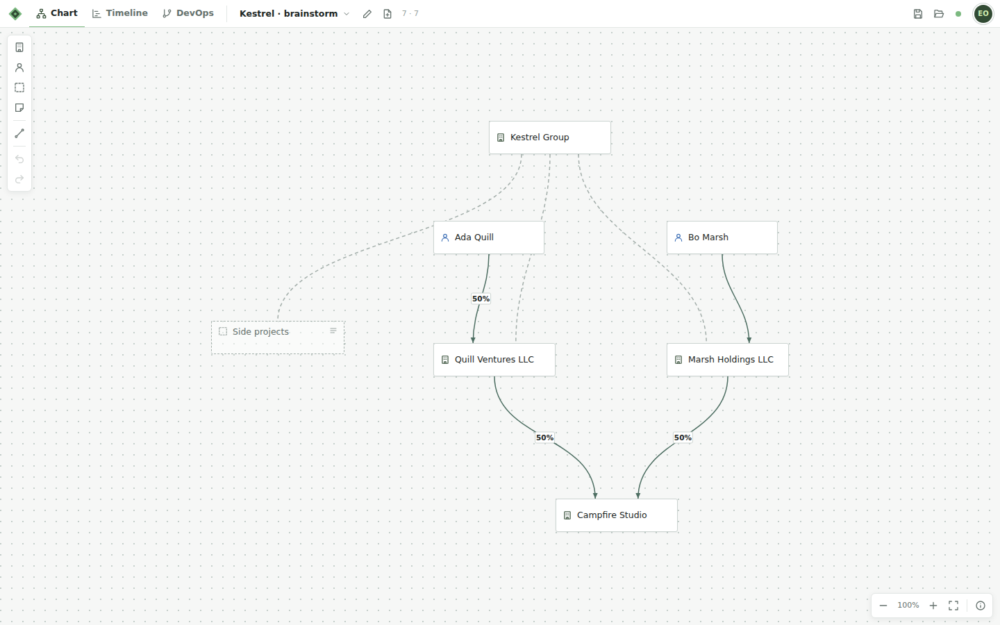
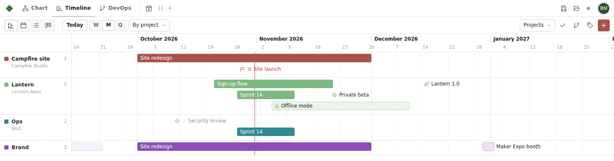
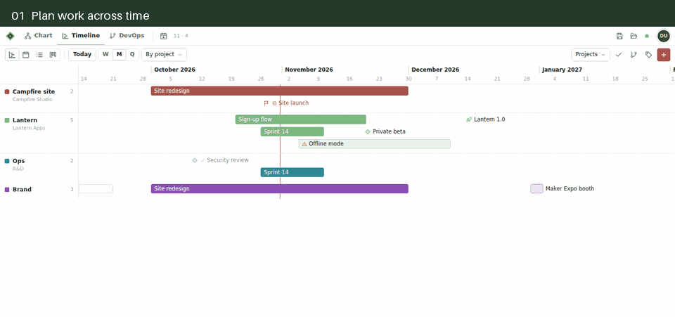
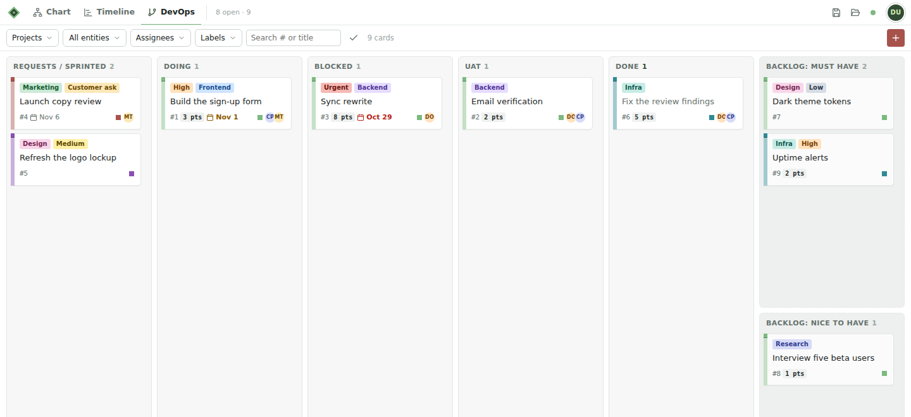
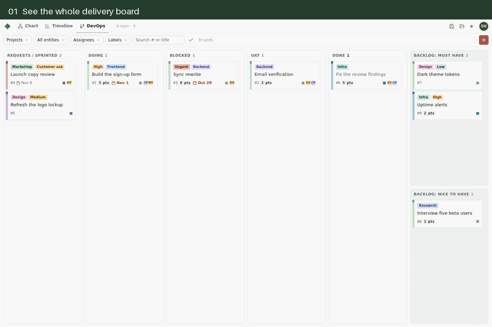

# Flow

**An open-source organization tool for mapping people and ideas, planning work, and tracking delivery.** Built by [Flygon LC](https://flygonlc.com) for anyone to use as a mind map, timeline, DevOps board, and agent org chart in one workspace.

Create mind maps of people, organizations, projects, and notes; connect them to plans on a timeline and cards on a work board. Flow runs locally without an account, or can be hosted with sign-in and separate private workspaces. It uses browser JavaScript and Node.js, with no frontend build step.



## Start locally

With Node.js 22 or newer:

```sh
git clone https://github.com/aribradshaw/flow.git
cd flow
npm ci
npm start
```

Open the URL printed by the server. In local mode it binds to `127.0.0.1`, tries port 4317, and advances to a free port if occupied. The exact URL is also written to `running.json`. No hosted service or account is needed. To use a particular port, set `PORT=4317` in your environment; an occupied explicit port produces an error.

For persistent storage, branding, and public hosting, see [Self-hosting](docs/self-hosting.md) and the commented [.env.example](.env.example).

On Windows, for a hidden background launch:

```powershell
Start-Process -FilePath 'C:\Program Files\nodejs\node.exe' -ArgumentList 'server.mjs' -WorkingDirectory $PWD.Path -WindowStyle Hidden -RedirectStandardOutput 'server.log' -RedirectStandardError 'server-error.log'
```

## Use

Hover any icon for a tooltip; the **?** in the top bar lists shortcuts for the current tab.

Use **MindMap** to map an organization, team, or idea; **Timeline** to plan projects and releases; and **DevOps** to move work from requests through completion. The three views share projects, people, and links, so you can start with whichever one fits your work.

**Timeline:** see projects, milestones, deadlines, and work at risk across time.



<details>
<summary>Watch Timeline switch between the timeline, calendar, status board, and list</summary>



</details>

**DevOps:** track requests, active work, blockers, testing, completed cards, and backlogs.



<details>
<summary>Watch a DevOps card open to show its checklist, assignees, and linked timeline item</summary>



</details>

In **Settings → Environment → Workflow**, choose Delivery, Simple, or Planning, then edit timeline status names and DevOps column names for your workspace. Stage IDs stay stable so saved items and automation continue to work. A self-hosted instance can also set its display name, accent, and logo through environment variables.

### MindMap
The free-form canvas of cards and connections (the API calls each mind map a *chart*).
- Floating palette (left): add entity / person / project area / note (E · P · A · N), connect (C), undo / redo. Double-click empty canvas to add an entity there.
- Cards snap to a 16px grid (hold Alt to place freely) and resize from the bottom-right corner. Moving an area carries every card fully inside it.
- Connect by dragging the dot on a card's right edge onto another card, or with connect mode. Edges sharing a card side spread out along it.
- Solid arrows are ownership (labelled with the %); dashed lines are grouping only. Unspecified percentages show "?" only when selected.
- The inspector opens only for a selection and autosaves as you type. It lists a card's connections; click one to jump to it.
- Selecting an entity or area opens its project timeline along the bottom: items from the Timeline project with the same name, fitted to the width. Click an item to open it in the Timeline; + adds an item tagged with that project (creating it if needed); → opens the Timeline filtered to it. Toggle the strip from the inspector's timeline icon.
- Right-click a card, a connection or empty canvas for a menu: rename, kind, connect, duplicate, share, DevOps cards, reverse or retype a connection, add a card right where you clicked, fit, zoom, undo. The menu key or Shift+F10 opens it from the keyboard.
- Top bar: switch / rename / create / delete mind maps, plus Save and Load (below).

### Timeline
- Items: milestone, release, deadline, project, phase/sprint, event. Status: planned, in progress, at risk, blocked, done, cancelled. Each has a start date, optional end date, project tags, owner, link and notes.
- Projects are coloured tags managed from the tag icon. MindMap entity and area names are offered as suggestions.
- Views (1 · 2 · 3): **Timeline** (Gantt always spanning at least ~15 months ahead, rows grouped by project, type or status; week / month / quarter zoom), **Calendar** (month grid), **List** (by month, overdue in red).
- Drag items to reschedule; drag a bar's right end to change its length. Double-click a row or calendar day to add an item there. N adds, T jumps to today.
- Filter by project and hide done items from the toolbar. Export .ics (respects filters) for Google/Outlook/Apple Calendar.
- **Product management.** Projects can sit under a mind map entity or area (Projects panel › "Under …", or the folder+ button in the MindMap strip). Features are an item type with priority (high / medium / low) and a target release; a release lists the items targeting it and how many are done. Items may be left without a date: they are backlog and appear only on the Board and List.
- **Board** (4): a kanban with one column per status; drag cards between columns to change status, + on a column (or double-click it) to add a feature there. Cards sort by priority, then date.
- Selecting an entity on the MindMap shows every project under it in the strip: project chips (open that project), next-up item, backlog count (opens the Board), new project, add item, Board and Timeline shortcuts.
- Undo/redo (Ctrl+Z / Ctrl+Shift+Z) covers charts and the timeline together; history resets on reload.

### DevOps
A card board for tracking work from requests through completion.
- Columns: Requests / Sprinted (where new cards land), Doing, Blocked, UAT, Done, then Backlog: Must Have and Backlog: Nice to Have stacked in one slot. On screens 1024px and wider the six slots fill the width; narrower screens scroll the board sideways. Double-click a column name to rename it; + on a column adds a card there. Each column shows 20 cards, then "Load more"; Done lists the most recently moved first. Boards saved with the older layout move Sprinted cards into Requests / Sprinted.
- Cards show label pills, title, `#number` (auto-incrementing), points, due date (red when overdue, amber within two days), checklist progress, a link icon, the project colour and assignee initials. Click a card for its panel: title, column, project, labels, points, due date, assignees (developer / tester / requester, picked from the chart's people), checklist, links (pull request, commit, URL), linked timeline item, description, created/updated.
- Clicking a card opens it in a modal that grows out of the card (two columns: text, checklist and links on the left; column, project, labels, dates, people and the timeline link on the right). `#devops/card/<number>` links to it, Back or Esc closes it, ←/→ (or K/J) step through the column. Timeline items open the same way. Confirmations (Done, reopen, deletes) are small dialogs on top.
- Column headers explain each column on hover: **UAT** needs testing before it can go to Done; **Done** means completed.
- Drag cards within and between columns. Gates: **Approve** on a UAT card moves it to Done; dragging straight into Done, or out of Done, asks first; moving an unassigned card into Doing asks who is developing it (cancel leaves it unassigned).
- Filters (remembered in this browser): projects (including "No project"), entity (cards in the projects under a chart entity or area), assignees, labels, search by `#number` or title, hide Done, Clear. The count shows visible cards.
- On the MindMap, a selected person, entity or area shows "N open cards" in the inspector; click it to open the board filtered to them. The MindMap's project strip shows open-card counts per project.
- On the timeline, a card can be linked to an item; the item's panel lists its cards. "Show DevOps cards" (Timeline view) draws cards that have a due date and a project as read-only markers; click one to open the card.

### AgentFlow
An org chart for agentic work: the agents (and people and teams) that run a business, what each one does, and the workflows they hand work through. Flow stores the design. Your own runner (an agent harness, a home server, cron) reads it through the API or MCP and does the work.
- **Org chart** (1): a canvas like the MindMap. Agents start laid out as a tree by who they report to, with larger teams stacked in compact columns; drag them anywhere (Shift: with their reports), pan and zoom, drag the dot under a card onto another agent to change who reports to whom (or onto empty space to add a report), double-click to add an agent, and **Tidy up** to return to the tree. Each card shows its kind (AI agent, human, team, automation), status, role, where it runs and on which model, a **Live** badge when it is switched on, input/output counts, workflows and open cards. Search dims everything that does not match. **Start from a template** adds a small example org and workflow to edit.
- Right-click an agent for kind, status, reports to, add to a workflow, **Open work queue** (its delegated cards on the board), copy brief and delete; empty canvas for add agent here, new workflow, fit and tidy up; a reporting line to remove it; a workflow card for status, duplicate, copy brief and delete.
- Click an agent for its side panel: name, kind, role, status, reports to (never one of its own reports), supervisor (a person on your MindMap), purpose, inputs, outputs, tools, where it runs and the model, instructions (system prompt or runbook), and linked projects, DevOps cards and timeline items. The panel lists its linked work, direct reports and workflow steps; `+` adds a direct report.
- Cards have an avatar (a person's photo for humans), name and role, where the agent runs and on which model(s), a **Live** badge, and a coloured status stripe; long text is cut short with the full text on hover, and below 60% zoom cards show just the avatar and name. Reporting lines join like a classic org chart (one trunk and bar per manager), and hovering or selecting an agent highlights its chain to the top.
- The side panel is split into collapsible sections (Identity, Runs on, Work, Instructions, Links, Team): status as coloured pills, searchable pickers with faces for Reports to and Supervisor, inputs, outputs and tools as chips, and a model picker that searches the runner's models grouped by provider with Included / Metered badges and starred favourites. The first model is the primary and the rest are fallbacks in order; **Auto** lets the runner pick from the list per card.
- **Live** switch at the top of an AI agent's side panel: off for every agent until you turn it on, and runners leave agents that are not live alone. **Runs on** and **Model** suggest the runners that reported to the workspace (`runners.report`) and their models. `tools/agent-runner.mjs` is a reference runner for T3 Code that works live agents' queues; it starts in dry-run mode.
- **Scheduled**: a tray on the org canvas listing the scheduled jobs your runners found (systemd timers, cron, Vercel or Railway crons, scheduled AI tasks), grouped by runner and group, with each job's schedule and last-run status. Drag a job onto an agent (or onto the canvas), or click **Promote**, to put it in the org. A job that does not use AI becomes an **Automation**: a smaller grey card with its schedule. It has no models and no Live switch, because it runs on its own schedule outside Flow. Runners send jobs with `runners.report`. Agents also have a **Schedule** field.
- **Workflows** (2): each workflow is a pipeline of steps, each one handled by an agent, started by hand, on a schedule or by an event. Edit, reorder and assign steps in the side panel.
- **Copy brief** puts a Markdown brief for the agent or workflow on the clipboard: purpose, reporting line, inputs, outputs, tools, steps and linked cards and deadlines. `agents.get` and `workflows.get` return the same brief over the API and MCP. See [docs/concepts/09-agentflow.md](docs/concepts/09-agentflow.md).
- **Delegate** a DevOps card to agents in its **Delegated to** picker (or `cards.update` with `agents`). Cards show their agents as square badges, the board has an **Agents** filter, and `agents.work` gives a runner the agent's brief plus its queue of open delegated cards, active work first. Deleting an agent moves its reports up to its manager.

### Split view
Show two tabs side by side, for example DevOps next to AgentFlow, or the MindMap next to the Timeline.
- Hover a tab you are not on and click the small split icon in its top-right corner: the current view stays on the left and that tab opens on the right. Both tabs then look selected, each with a mark for its side.
- The pane you last clicked or tabbed into has **focus** (a thin green line along its top). The header, the side panel, keyboard shortcuts and Esc all follow it, so `N` adds to the focused view only. Selections in the other pane stay put; its side panel comes back when you focus it again.
- Clicking one of the two shown tabs focuses its pane. Clicking any other tab replaces the focused pane. A link that opens another view (a card's agent, a person's DevOps cards) opens it in the other pane, so the view you came from stays in sight.
- Drag the divider to resize (each pane keeps at least 360px), or double-click it for 50/50. With the divider focused, the arrow keys resize too.
- Hover either shown tab and click the × in its corner to close that pane; the other view fills the window.
- The split and its ratio are remembered on this device, and the address shows both tabs (`#devops|agentflow`), so Back, Forward and links work; older links such as `#timeline` or `#devops/card/12` still open one view. Windows narrower than 900px show only the focused pane until there is room again.

### Shared UI pieces
- **Pickers** (`ui.js`): `pickerButton(key, label, items, selected)` renders a trigger ("Projects · 2" with colour dots); `openPicker(trigger, {items, selected, onChange, multi})` opens a searchable listbox popover (arrows, Enter/Space, Esc, type to filter, Select all / Clear). Used for the DevOps and Timeline filters and card labels/assignees. Plain single selects are styled native `<select>`s.
- **Motion and skeletons** (`motion.js`, documented at the top of the file): `swap({from, update, to})` animates tab changes (View Transitions API when available), `enter(root, groups)` staggers a view in, `busy(el, promise)` / `skeletonize(el)` / `skeletonAppend(list, n)` / `unskeletonize(el)` show shimmer placeholders measured from the element's real layout (`data-no-skeleton` opts out). All of it respects `prefers-reduced-motion`. A new module opts in by calling these; no skeleton markup is needed.

## Sign-in and environments
Without sign-in configuration, Flow runs in **local single-user mode** on your computer. Set `FLOW_LOCAL_EMAIL` and `FLOW_LOCAL_NAME` if you want to choose the local identity.

**OneProfileID** (native sign-in, `lib/auth.mjs`, following OneProfileID's `docs/native-auth.md`): set all four of these in `.env` or the environment (a partial set refuses to start):
- `OPID_BASE_URL`: the OneProfileID native service origin (https in production).
- `OPID_APP_ID`: this app's registration id.
- `OPID_APP_SECRET`: its client secret (at least 32 characters; never sent to the browser).
- `OPID_APP_ORIGIN`: the exact origin this app is served from.

Hosted sign-in currently requires a native app registration provisioned by a OneProfileID operator; see [Self-hosting](docs/self-hosting.md) for the setup and current availability. Sign-in sessions survive deploys: with `DATABASE_URL` they are stored in the additive `flygon_flow_sessions` table (only a SHA-256 hash of the session id, with idle and absolute expiry; sign-out deletes the row), otherwise in memory. The browser posts email/password (and a two-factor code when asked) to `/api/auth/*`; the server calls OneProfileID with the app secret, forwards its cookies, requires a membership for the registered app, and keeps its own httpOnly SameSite=Lax session (Secure on https). Every protected request revalidates the central session. `/api/auth/session`, `sign-in`, `two-factor` and `sign-out` are the routes.

**Environments** (`lib/environments.mjs`): each workspace carries `environment: {id, name, ownerEmail, visibility: 'private'|'public', members: []}` (`members` is reserved for invites). Existing workspaces retain their environment identity when upgraded. Save, load and backup only return environments the signed-in user owns or that are public; others get 404, and public ones are read-only for non-owners. The registry is `data/_environments.json`. The Postgres changes are additive and idempotent (`add column if not exists env_id, env_owner, env_visibility` on the saves table, plus a `flygon_flow_environments` table) and run when the server first uses the cloud.

`node verify.mjs` tests all of this against a loopback mock of OneProfileID with synthetic users; it never contacts the real service or database.

## Versions and DevLog
Public release tags use the commit's Bradshaw Versioning number (`vYEAR.MONTH.UPDATE`, see below) and user-facing notes in [CHANGELOG.md](CHANGELOG.md). The source CLI currently runs from a clone with `node tools/flow.mjs`; the npm package is private and has not been published. See [Release process](docs/releases.md).

Flow uses [Bradshaw Versioning](https://github.com/aribradshaw/devlog/blob/main/docs/bradshaw-versioning.md) (draft 1.0): every commit that reaches `main` gets the next `YEAR.MONTH.UPDATE`, with a zero-based project year (year = calendar year − 2026), calendar months, and the America/Phoenix timezone. The public source history starts at the clean baseline recorded in `public/devlog.json`; earlier releases are historical metadata.

- The registry is `public/devlog.json`: [DevLog](https://github.com/aribradshaw/devlog) entries (validated in `verify.mjs` with `@aribradshaw/devlog`, a dev dependency) plus `sequence`, `admittedAt`, `compatibility` (compatible, action-required or breaking) with the required `action`, and `deployments`, which stays empty until a deployment is verified. Version identity says nothing about deployment.
- Recording, done by the release coordinator after each push: `node tools/devlog.mjs status` lists unrecorded commits; `node tools/devlog.mjs record <sha> --at <push time> --compat <class> --note "..."` records the next one, in order.
- Disclosed deviation of the draft: registry-only commits are numbered like any commit, but a registry update cannot contain its own SHA, so it is recorded by the next update. The newest commit on `main` can therefore be assigned but not yet listed. The registry is a single-writer file in Git rather than an atomic service.
- The public repository starts from a clean root commit. Earlier private development commits are represented by release metadata only; their source and ancestry are absent from this repository.
- In the app, the version shows next to Settings in the account menu; Settings › DevLog lists the releases (paged) with links to each commit.

## Deploying
- `npm ci && npm start` (Node 22 or newer). Without OPID_* the server only listens on 127.0.0.1 and refuses a public `HOST`; with OPID_* set it listens on `HOST` (default `0.0.0.0`) at `PORT`.
- Set `OWNER_EMAIL` to the address that should own your instance. That account gets the app's `owner` membership on its first verified OneProfileID sign-in; everyone else needs an invite and a claimed app membership.
- Storage: `BACKUP_DIR`, `SAVES_DIR` and `INBOX_DIR` (e.g. a volume at `/data/backups`, `/data/saves`, `/data/inbox`; the inbox defaults beside `BACKUP_DIR`). The environments registry lives in `BACKUP_DIR`.
- Cloud saves: `DATABASE_URL`; set `DATABASE_SSL=no-verify` for a TLS proxy with a self-signed chain (e.g. Railway's public URL), or `DATABASE_SSL=1` for verified TLS.

## Agent inbox
Agents (Claude, Codex, T3...) can add or update cards, timeline items, projects and labels without anyone pressing Load. They drop a JSON patch with the CLI; the open app picks it up on load and every 20 seconds while the tab is visible, merges it as **one undoable step** (a toast offers Undo) and saves it like any other edit.

```powershell
node tools/inbox.mjs add patch.json     # validate and queue (fills id / createdAt if missing)
node tools/inbox.mjs check patch.json   # validate only
node tools/inbox.mjs list               # pending and applied
node tools/inbox.mjs requeue <id>       # put an applied patch back (re-applying is safe)
```

Patches live in `inbox/` (gitignored; `INBOX_DIR` overrides it). The first tab to claim a patch moves it to `inbox/applied/` with `appliedAt`; nothing is ever deleted.

```json
{
  "source": "Claude",
  "env": "your-environment-id",
  "ops": [
    {"op": "upsertProject", "name": "Lantern", "entity": "Lantern Apps", "color": "#7cb980"},
    {"op": "upsertLabel", "id": "l-research", "name": "Research", "section": "area", "color": "teal"},
    {"op": "upsertItem", "title": "Public beta", "project": "Lantern", "kind": "release", "start": "2026-12-01"},
    {"op": "upsertItem", "title": "Sign-up flow", "project": "Lantern", "kind": "feature", "priority": "high", "release": "Public beta"},
    {"op": "upsertCard", "title": "Build sign-up form", "project": "Lantern", "column": "requests",
     "labels": ["High", "Frontend"], "assignees": [{"name": "Cleo Park", "role": "developer"}],
     "due": "2026-11-15", "points": 3, "item": "Sign-up flow",
     "checklist": [{"text": "Email field"}, {"text": "Validation", "done": false}],
     "links": [{"kind": "pr", "url": "https://github.com/..."}], "description": "Why this card exists..."},
    {"op": "patchCard", "number": 12, "column": "uat", "checklist": [{"text": "Email field", "done": true}]}
  ]
}
```

- `id` (letters, digits, `-`, `_`) and `createdAt` (ISO) are filled in by the CLI when missing. Set `env` to the environment you want to edit. The current CLI defaults to the legacy environment id `default-workspace` when `env` is omitted.
- **Matching:** projects by name; labels by id (or name when referenced); items and cards by `id`, otherwise exact title plus project; `patchCard` by `number` or `id`.
- **References are names:** `project`, `entity` (a chart entity or area), `assignees[].name` (a person card on the chart; role developer, tester or requester), `item` and `release` (timeline titles), `labels` (label id or name). A missing project is created; other missing references are skipped and noted.
- Item fields: `title, kind, status, priority, start, end, projects[], owner, link, notes, release`. Card fields: `title, description, column, project, labels[], points, due, assignees[], checklist[], links[], item`. Columns: `requests, doing, blocked, uat, done, must, nice`.
- **Safety:** ops only add or update, never delete; lists only grow. If a person changed a card after the patch's `createdAt` (or a timeline item since the inbox last wrote it), their values are kept and the toast says how many edits were kept. Applying the same patch again changes nothing.

## Settings, shortcuts and preferences
- The account menu (top right) opens **Settings**; the version next to it opens the **DevLog** tab. Tabs: Account · Environment · Shortcuts · DevLog; the last tab is remembered.
- **Shortcuts** live in one registry (`public/shortcuts.js`) that every key handler and tooltip reads. In Settings › Shortcuts, click a shortcut and press new keys: conflicts in the same scope offer a swap, browser-reserved combos (Ctrl+W/T/N/Tab, F5, ...) are refused, and each row (or everything) can be reset. Keys show as Ctrl on Windows and ⌘ on Mac.
- **Preferences** (`public/prefs.js`: shortcuts, Settings tab, room for more) are cached in localStorage (`flygon-flow-prefs`) and saved per user on the server (`GET`/`PUT /api/prefs`, `BACKUP_DIR/prefs/<user>.json`, plus the additive `flygon_flow_prefs` table when `DATABASE_URL` is set). On start the server copy wins.
- The DevLog tab reads `GET /api/devlog?page=N&q=text` (10 releases a page) and links to [DevLog](https://github.com/aribradshaw/devlog).

## People and environments
- **App invites** (owner only): Settings › Account › *Invite to Flow*. Inviting an email does not send anything; the person signs in at the app with OneProfileID using that address (existing accounts complete their usual two-factor or passkey step). On that first sign-in the server claims their own Flow membership (`/membership/claim` with the invite's id and their verified email, never `owner`). Revoked invites give no access. API: `GET/POST/DELETE /api/invites`.
- **Invite email**: inviting (or *Resend*) sends a branded email through Resend when `RESEND_API_KEY` and a verified `FLOW_EMAIL_FROM` sender are set. Without both, the invite is still recorded and the UI says email is not configured. Sends are rate-limited (20 an hour per inviter, 3 an hour per recipient). Owner CLI: `node tools/env.mjs invite <email> --to <url> [--resend | --no-email]`, `invites`, `revoke <email>`, `environments`, `archive <envId>`. Tests use `FLOW_EMAIL_TRANSPORT=file:<path>` and never send.
- **Own environments**: everyone starts in a new, empty, private environment. The account menu lists your environments to switch between; Settings › Environment creates, renames and archives them (archived ones are hidden and their data is kept). API: `GET/POST /api/environments`, `PATCH/DELETE /api/environments/<id>`.
- **Isolation**: environments are only visible to their owner (or, later, people they are shared with); anything else answers 404. `verify.mjs` checks that users cannot read one another's private environments.

## Server sync (the server is the source of truth)
Each environment's workspace (charts, projects, timeline, DevOps and the environment record) lives on the server with a revision number: in Postgres when `DATABASE_URL` is set (tables `flygon_flow_workspaces` and `flygon_flow_workspace_history`, additive, created idempotently on first use), otherwise in `BACKUP_DIR/workspaces/`. Every write keeps the previous revision in the history. Browser storage is the offline cache.

- `GET /api/workspace[?env=<id>][&since=<rev>]` and `PUT /api/workspace?env=<id>` with `{baseRev, data}`. A save from an old revision gets `409` with the newer copy; the browser merges per entity and field (`public/sync-core.js`: a side's change beats an unchanged value, both changed prefers local, deletions only apply to untouched entities) and retries. A save that would drop most of a large workspace is refused (`422`) unless it is a deliberate load/replace.
- On load the browser asks the server first. An empty server never replaces local data: the browser uploads instead. An untouched new workspace is not uploaded. A fresh browser takes the server copy. Remote changes are picked up every 20 seconds while the tab is visible, and offline edits upload on reconnect. The agent inbox merges through the same path.
- `FLOW_SYNC_TOKEN` (32+ characters) lets tools act as the owner (`Authorization: Bearer …`). Import a backup once with `node tools/env.mjs push --env <environment-id> --from data/<backup>.json --to https://flow.example.com`. Running it again is a no-op, and it refuses to overwrite a server that has data unless you pass `--merge` (nothing dropped) or `--replace` (the old copy stays in the history). `pull` and `status` are there too.
- A local app (`127.0.0.1`, local mode) with `FLOW_SYNC_URL=https://flow.example.com` and the same `FLOW_SYNC_TOKEN` relays its workspace calls to that server, keeping its own copy as the offline fallback; its log line and the save-status tooltip name the server it syncs with. Without them it works locally. Test servers never relay to a non-loopback URL.

## Storage

Charts automatically save in browser localStorage on this exact origin. Keep using the same browser/profile and port. A different port has a different browser storage area; return to the original address to see that data. Clearing browser data removes the browser copy; use Save for durable snapshots.

**Save / Load.** Save (Ctrl+S) snapshots the whole workspace (charts, projects, timeline and DevOps) to `saves/` on this computer (newest 200 kept) and, when `DATABASE_URL` is set, to Postgres in the `org_chart_studio_saves` table. Without Postgres, saves are local only. Load lists snapshots from both places, newest first; loading replaces the workspace and is undoable with Ctrl+Z. "From a file…" in the Load menu accepts a saved workspace or an old single-chart JSON export.

New installations load a fictional starter mind map. Replace its people and organizations with your own before using it as a record of a real structure.

## Extend

`public/app.js` exposes `window.flygonFlow.registerTool({ id, label, icon, run })` (`window.orgChartStudio` remains as an alias). The tool appears in the floating palette (`icon` is an optional name from `public/icons.js`; `label` becomes its tooltip). The run callback receives `addNode(type)`, `getChart()` (a copy), and `mutate(fn)` (undoable and persisted).

Code lives in ES modules under `public/`: `app.js` (shell, canvas, inspector), `timeline.js`, `devops.js` (DevOps board UI), `devops-core.js` (board data, validation and pure helpers), `agentflow.js` and `agentflow-core.js` (AgentFlow view and data), `store.js` (persistence, validation, undo), `ui.js` (tooltips, helpers), `icons.js`. Saved data keeps the original v1 chart schema; `projects`, `timeline`, `devops` and `agentflow` are additive fields (older saves get an empty board with the default columns and labels), and cards may carry optional `w`/`h`.

## Verification

`npm run check` checks syntax. `node verify.mjs` runs end-to-end checks in headless Edge against its own server on port 4399 with a throwaway profile, so it never touches the live instance or your saved data. It covers snapping, resizing, undo, port connections, inspector autosave, keyboard adding, timeline items/projects/drag-rescheduling, all three timeline views, reload persistence and the disk backup. `seed-canvas.png` is captured during the run. The Timeline and DevOps README media can be regenerated from fictional demo data with `node tools/capture-readme.mjs` (Chromium; set `BROWSER` if needed) and `python3 tools/build-readme-gifs.py` (Pillow 10.1 or newer).

## Autosave
Inspector fields autosave valid edits as you type. The coloured dot in the top bar shows save state; hover it for details. Browser storage saves immediately; disk backups follow after 400 ms. Backups live in data/<browser-id>.json with the prior snapshot in <browser-id>.previous.json. Each browser gets a separate ID so an older chart in another browser cannot overwrite yours. The status indicator confirms disk writes and reports retries.


## Built by Flygon LC

Flow is made by [Flygon LC](https://flygonlc.com) and licensed under [MIT](LICENSE).
